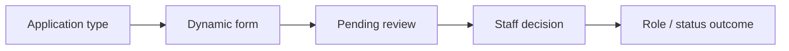

# RP Character Application Review

**Roleplay character/quenta application workflow**

  

> **Documentation-only portfolio case study.** The source under [`src/public_interface.py`](src/public_interface.py) is intentionally unimplemented and raises `NotImplementedError`. This is **not** a runnable bot, a deployment package or independently verified production evidence.

## Why this module exists

Roleplay communities may use multiple character application types with different fields, reviewer roles and downstream permissions. A consistent approval workflow must preserve the submitted data and avoid granting role benefits before the reviewer decision is committed.

**Technology context:** Python, discord.py forms, JSON/JSONC configuration and persistent views. These technologies describe the private module's documented domain; public executable implementation is not provided.

## Workflow at a glance

1. Select an application type and the corresponding schema
2. Collect the character submission through a form
3. Persist a pending application and notify the correct reviewers
4. Record an authorized approve/reject decision
5. Apply any configured role outcome and communicate final status

These stages summarize the public project description; the exact runtime and private integration details cannot be independently verified from the public skeleton.

## Engineering challenges

| Topic | Why it matters | How it should be verified |
|---|---|---|
| Schema evolution | Application fields may change while cases are pending | Version submissions or preserve original field names |
| Role delivery | Approval can persist while Discord role granting fails | Track decision and delivery separately |
| Reviewer isolation | Different applications may need different staff groups | Check permissions per application category |
| Replay safety | Repeated button clicks must not grant twice | Use idempotent decisions and audit history |

## Component boundary

This diagram is **conceptual**, not a snapshot of private production architecture. See the [design notes](docs/ARCHITECTURE.md) for boundaries, failure scenarios and test ideas.

## Repository contents and status

- [`src/public_interface.py`](src/public_interface.py) — non-runnable, documented public interface skeleton
- [`docs/ARCHITECTURE.md`](docs/ARCHITECTURE.md) — engineering design notes (no operational secrets)
- [`examples/config.example.jsonc`](examples/config.example.jsonc) — illustrative configuration shape, **not** a production configuration
- [`NOTICE.md`](NOTICE.md) and [`SECURITY.md`](SECURITY.md) — publication/security boundary

**Portfolio role:** Private-source RP application module showcase. No public tests, executable deployment or usage metrics are claimed here. For verifiable code, inspect the [FastAPI backend demo](https://github.com/Scumbagsss/priority-access-bot), [ticket workflow](https://github.com/Scumbagsss/advanced-discord-ticket-bot) and [monitoring pipeline](https://github.com/Scumbagsss/dayz-server-monitor-bot).

**Related systems:** [faction-reservation-bot](https://github.com/Scumbagsss/faction-reservation-bot) · [BOT](https://github.com/Scumbagsss/BOT).

**Contact:** Discord `scumbagsss` · Telegram [@dilarion](https://t.me/dilarion)
